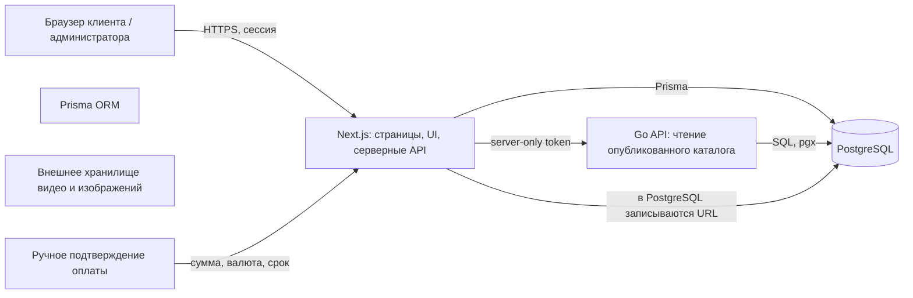

# MathMentor AI — архитектура платформы

Документ относится к приложению в каталоге `math/`.

> Документ описывает фактическое состояние MVP и целевое направление развития. Самостоятельная регистрация и автоматическая онлайн-оплата пока отключены. Клиентов создаёт администратор, а курсы назначает вручную.

## 1. Назначение продукта

Закрытая образовательная платформа: администратор управляет клиентами, оплатами, сроками доступа и учебными материалами; клиент входит в личный кабинет, проходит назначенные курсы, смотрит видео, решает задания и видит свой прогресс.

**Основной путь клиента**

1. Администратор подтверждает оплату, создаёт аккаунт клиента и задаёт число дней доступа.
2. Администратор назначает клиенту один или несколько опубликованных курсов.
3. Клиент входит на сайт и сразу попадает в свой кабинет — без публичного лендинга и регистрации.
4. В кабинете отображаются только назначенные клиенту курсы, обложки, прогресс и ближайший незавершённый урок.
5. Клиент смотрит урок, решает задания или отмечает урок без заданий как пройденный, затем переходит к следующей теме.
6. Все проверки роли, срока доступа и назначения курса выполняются на сервере.

## 2. Технологический стек и потоки данных



### Текущее разделение

- **Frontend — Next.js / React / TypeScript / Tailwind.** Страницы входа, личного кабинета, курса и урока; административные редакторы курсов и клиентов.
- **Backend — серверная часть Next.js.** Маршруты `/api/*` проверяют сессию, роль, подписку и назначение курса; используют Zod для валидации входных данных.
- **Go API.** Сейчас обслуживает чтение опубликованного каталога курсов. Доступ к нему закрыт серверным `GO_BACKEND_API_TOKEN`; браузеру секрет не передаётся.
- **Database — PostgreSQL через Prisma.** Хранит аккаунты, учебную структуру, назначения, оплаты, сроки доступа, результаты заданий и прогресс.
- **Media.** Видеофайлы хранятся в Cloudflare R2, а не в PostgreSQL. В БД лежит только ключ объекта (`Lesson.videoObjectKey`).

### Целевой принцип развития

```text
Frontend (тонкий UI)
    → Backend API (авторизация, бизнес-правила, валидация, интеграции)
        → PostgreSQL через слой репозиториев / Prisma или Go SQL
        → внешние сервисы: платежи, видео, AI, почта
```

Сначала стабилизируем текущие сценарии и контракты API. Затем переносим связанные операции доменами, а не переписываем всё одновременно: доступ и платежи → обучение и прогресс → администрирование и дополнительные интеграции. Каждый этап сохраняет тесты API и миграции базы.

## 3. Модель данных сегодня

Основная цепочка учебного контента:

```text
Course 1 ── * Module 1 ── * Lesson 1 ── * Question
                              │
                              ├── * Test
                              ├── * LessonProgress * ── 1 User
                              └── * QuizAttempt    * ── 1 User

User 1 ── * Enrollment * ── 1 Course
User 1 ── * Subscription
User 1 ── * Payment
User 1 ── * Session
```

В базе сейчас **12 таблиц Prisma-моделей** и **2 enum**. Первичные ключи — строковые `cuid`; даты создаются на сервере/базе, где указано в модели.

| Таблица | Назначение и основные поля |
|---|---|
| `User` | Клиент или администратор: `name`, уникальный `email`, `passwordHash`, `googleId`, `role` (`STUDENT` / `ADMIN`), `isActive`, временные метки. Связан с сессиями, назначениями, оплатами, подписками, прогрессом и попытками. |
| `Session` | Серверная сессия: `userId`, уникальный хеш токена `tokenHash`, `expiresAt`, `createdAt`. Сам токен хранится только в HTTP-only cookie; есть индексы по пользователю и сроку сессии. |
| `Course` | Курс: уникальный `slug`, `title`, `description`, `coverImage` (URL), `price`, `level`, `isPublished`, временные метки. Обложка — внешний URL, не бинарное содержимое. |
| `Module` | Модуль курса: `courseId`, `title`, `coverImage` (URL), порядковый номер `order`, `createdAt`. |
| `Lesson` | Урок: `moduleId`, `title`, `videoUrl`, `theory`, `desmosConfig` (JSON), `order`, `createdAt`. Видео хранится вне БД, в записи — только ссылка. |
| `Question` | Задание урока: `lessonId`, `prompt`, enum `type` (`MULTIPLE_CHOICE` / `NUMERIC` / `FORMULA`), JSON `choices` и `correctAnswer`, `createdAt`. |
| `Test` | Задел под тесты: `lessonId`, `title`, `createdAt`. Отдельные вопросы тестов пока не выделены в самостоятельную модель. |
| `Enrollment` | Назначение конкретного курса конкретному клиенту: `userId`, `courseId`, текстовый `status` (сейчас `ACTIVE` / `REVOKED`), `createdAt`; уникальная пара `(userId, courseId)`. Это таблица связи «клиент ↔ курс». |
| `Subscription` | Период оплаченного доступа клиента: `userId`, `status`, `planName`, `startedAt`, `purchasedAt`, `expiresAt`, опциональный внешний `stripeId`. В MVP периоды создаёт администратор после ручного подтверждения платежа. |
| `Payment` | История оплаты: `userId`, сумма `Decimal(12,2)`, `currency`, опциональный `stripeId`, `status`, `createdAt`. Оплата в MVP записывается администратором; автоматической проверки транзакции пока нет. |
| `LessonProgress` | Текущее состояние прохождения урока: `userId`, `lessonId`, `completed`, `progress` от 0 до 100, `updatedAt`; уникальная пара `(userId, lessonId)`. |
| `QuizAttempt` | История попыток заданий: `userId`, `lessonId`, `score`, `total`, JSON `answers`, `submittedAt`; индексы по пользователю/дате и уроку. |

### Enum

- `Role`: `STUDENT`, `ADMIN`.
- `QuestionType`: `MULTIPLE_CHOICE`, `NUMERIC`, `FORMULA`.

### Правило доступа

Клиент видит содержимое курса, если одновременно выполняются все условия:

```text
User.isActive = true
AND есть действующая серверная сессия
AND есть Subscription со status = ACTIVE и expiresAt > сейчас
AND есть Enrollment для пары (этот User, этот Course) со status = ACTIVE
AND Course.isPublished = true
```

Администратор проходит проверку назначенного курса как владелец, но административные маршруты всё равно требуют роль `ADMIN`. В интерфейсе скрытие ссылок — только удобство; оно не заменяет серверную проверку.

### Активность и прогресс

Отдельной таблицы `Activity` пока нет. Лента кабинета формируется из `LessonProgress.updatedAt` и `QuizAttempt.submittedAt`. Текущий прогресс курса — отношение завершённых уроков к общему количеству уроков; статические демонстрационные значения не используются.

## 4. Доступ к видео и изображениям

- `Course.coverImage`, `Module.coverImage` и `Lesson.videoUrl` хранят URL, а не файл.
- Для YouTube используется встроенный privacy-enhanced iframe; прямые видео-ссылки проигрываются HTML video player.
- Обложки задаются в редакторе и загружаются браузером напрямую по URL.
- Прямой URL сам по себе не защищает платный контент. Для приватных видео в дальнейшем следует использовать подписанные ссылки/токены провайдера и выдавать их только после серверной проверки доступа.
- Загрузка видео администратором: `POST /api/admin/lessons/[lessonId]/video` выдаёт presigned PUT-ссылку на R2 (15 минут), браузер загружает файл напрямую в bucket, затем `PUT` с ключом подтверждает загрузку: сервер проверяет размер (до 2 ГБ через HeadObject), сохраняет `videoObjectKey` и удаляет предыдущий объект. `DELETE` удаляет файл.
- Ключ объекта имеет вид `lessons/<lessonId>/<uuid>.<ext>`. Допустимые типы: mp4, webm, mov.
- Воспроизведение: `GET /api/lessons/[lessonId]` после проверки доступа возвращает presigned GET-ссылку на 1 час. Публичная ссылка на R2 не выдаётся.
- Бакет R2 должен разрешать CORS PUT/GET с origin приложения, иначе браузерная загрузка не сработает.
- Go-каталог `/api/v1/courses` не получает видеоссылки R2 (там `videoUrl` остаётся пустым для загруженных видео).

## 5. Административные и клиентские сценарии

### Администратор

- `/admin` — сводка и переходы по управлению.
- `/admin/courses` — создать и опубликовать курс, задать описание и обложку, создать модули с обложками, добавлять и редактировать уроки, ссылки на видео и задания. С этой страницы есть явная кнопка «Назад в администрацию».
- `/admin/students` — создать клиентский аккаунт и записать оплату/срок; продлевать срок; назначать опубликованные курсы галочками.
- Изменения назначений записываются в `Enrollment`; снятые назначения получают статус `REVOKED`.

### Клиент

- После входа корневой URL открывает кабинет; публичного лендинга и самостоятельной регистрации нет.
- В кабинете отображаются только назначенные курсы из базы, их обложки и реальный прогресс.
- Кнопка «Продолжить» ведёт на первый незавершённый урок курса.
- Урок показывает номер в курсе, навигацию назад, видео, теорию, задания и переход к следующей теме после успешной проверки (не менее 70%); если заданий нет, клиент может отметить урок пройденным.
- Последняя активность основана на сохранённых изменениях прогресса и попытках заданий.

## 6. Миграции и безопасные изменения базы

1. Изменять `math/prisma/schema.prisma`, не редактировать сгенерированный Prisma Client вручную.
2. Создать проверяемую SQL-миграцию и обновить клиент командой `npm run db:generate`.
3. Применить миграции локально и проверить `npx prisma migrate status`.
4. Для production применять проверенные миграции (`prisma migrate deploy`) до выкладки приложения.
5. Не удалять клиентские оплаты, назначения и прогресс каскадом без отдельной политики архивации/удаления.

На текущей ветке в схему добавлено поле обложки `Module.coverImage`; перед запуском на базе необходимо применить миграцию `20261110153000_module_cover_image`. Миграция `20261110100000_payment_amount_decimal` переводит сумму оплаты в точный десятичный тип. Перед применением на базе с реальными финансовыми данными следует сделать резервную копию и проверить преобразование старых значений.

## 7. План развития

### Этап A — надёжный MVP

- Применить миграции и настроить резервное копирование PostgreSQL.
- Добавить интеграционные тесты для входа, срока подписки, назначения/отзыва курса и изоляции данных.
- Добавить поиск клиентов/курсов и историю платежей в интерфейс администратора.
- Сохранять историю изменений доступа и назначений, чтобы видеть кто/когда изменил доступ.
- Покрыть тестами порядок уроков, прохождение задания и переход к следующей теме.

### Этап B — медиа и уроки

- Выбрать видеопровайдера; реализовать загрузку/управление видео, приватное воспроизведение и краткоживущие ссылки.
- Добавить время видео и сохранение позиции просмотра.
- Выделить содержимое урока в расширяемые блоки (текст, формула, изображение, график, видео), не превращая PostgreSQL в хранилище файлов.
- Создать полноценные тесты, объяснения ответов, попытки и повторение тем.
- Подключить Desmos/MathLive/KaTeX через изолированные компоненты урока.

### Этап C — платежи и самообслуживание

- Интегрировать выбранную платёжную систему через backend checkout и проверенные webhook-события.
- Не активировать срок доступа по клиентскому редиректу: только после верифицированного события платежа.
- При необходимости открыть регистрацию по приглашению или после оплаты; сохранить роль `STUDENT` по умолчанию.
- Добавить письмо с входом/сбросом пароля и уведомления об окончании доступа.

### Этап D — разделение backend

- Переносить доменные API в Go небольшими пакетами: `auth`, `catalog`, `enrollment/access`, `learning/progress`, `payments`, `admin`.
- Переносить бизнес-правила и валидацию вместе с API-контрактами; фронтенд вызывает стабильный HTTP API и не знает схему PostgreSQL.
- Ввести версионирование `/api/v1`, OpenAPI-контракт, request ID, структурированные логи и метрики.
- Оставить Next.js для страниц, SSR и BFF-поведения только там, где это улучшает UX; секреты интеграций хранить исключительно на сервере.

### Этап E — новые функции

- Роли и разрешения администратора/редактора; журнал действий.
- Купоны, разные тарифы, гранты и доступ к нескольким курсам.
- Отчёты по активности и успеваемости, напоминания, экспорт данных.
- AI-подсказки с ограниченными правами доступа к контенту.
- Локализация, доступность, мобильная адаптация и проверка производительности.

## 8. Принципы расширяемости

1. **Бизнес-правила на сервере.** Не доверять скрытым кнопкам, форме браузера или client-side данным.
2. **Единая проверка доступа.** Одинаковые условия для HTML-страницы, API чтения урока, отправки ответов и сохранения прогресса.
3. **Стабильные связи.** Назначение курса — явная запись `Enrollment`, а не список ID в JSON или поле пользователя.
4. **Внешнее медиа.** PostgreSQL содержит идентификаторы и метаданные, большие файлы хранятся у провайдера.
5. **Аудируемые деньги.** Суммы — `Decimal`, валюта — код ISO 4217, каждое продление добавляет запись платежа/периода вместо перезаписи истории.
6. **Миграции прежде кода.** Любое изменение схемы идёт версионированной миграцией и проверкой отката/резервной копии.
7. **Добавление модулей без переписывания ядра.** Новые функции подключаются к отдельным API-доменам и моделям, не обходя существующие правила доступа.
